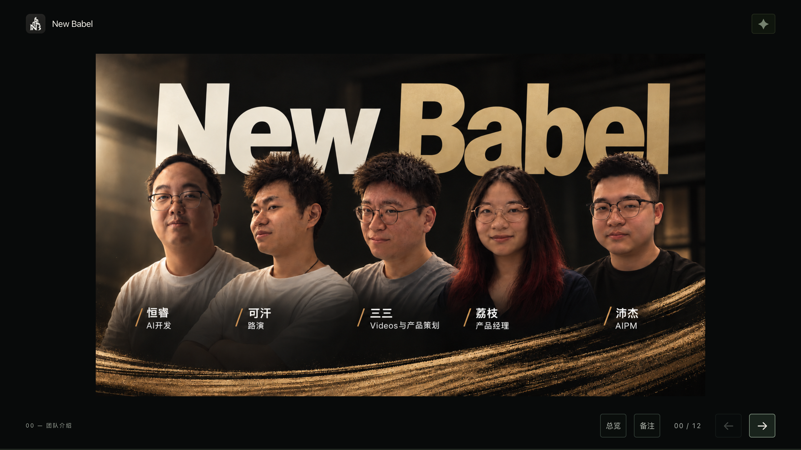
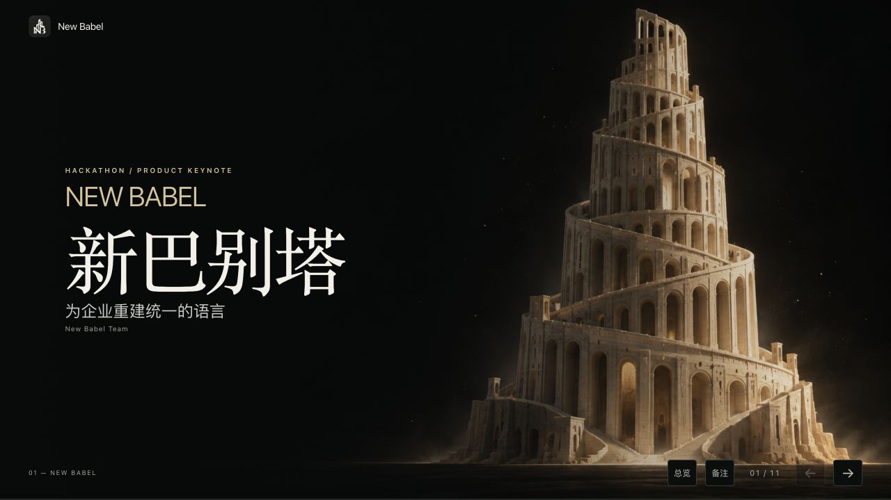
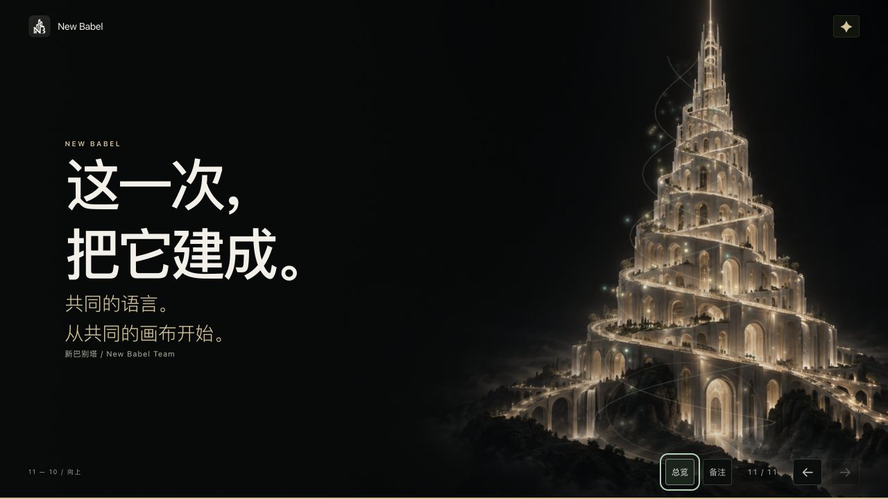
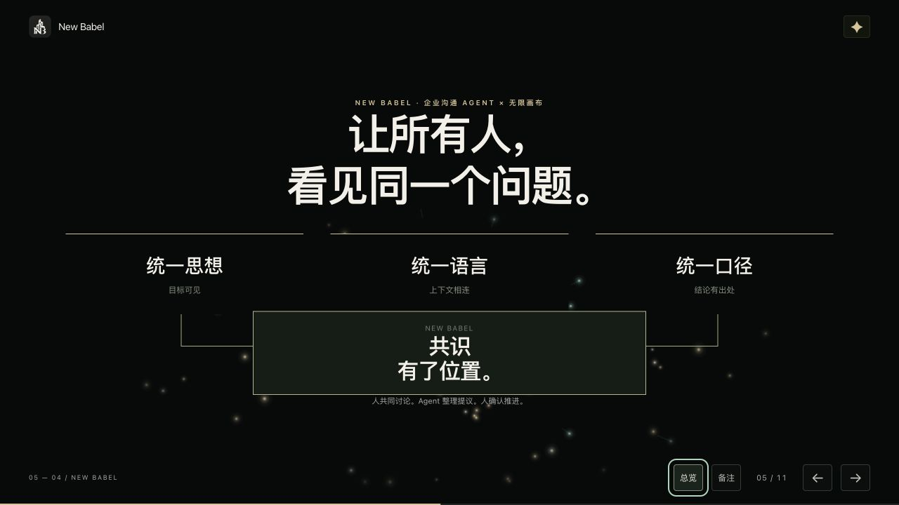

# 路演验收记录

日期：2026-10-11。对象：本地 reveal.js 6.0.2 路演，随后使用相同静态资源在独立 Docker 项目 `new-babel-keynote` 中验收。

## 团队页与宣传视频更新（同日）

- 内容检查：`npm run check` 已更新为 13 页（00–12），校验团队页、宣传视频页、hash ID、本地资源、Demo 链接、Reveal MIT 许可及 MP4 静态服务回归；11 项全部通过。
- 页面顺序：00 团队介绍、01 原封面、02 宣传视频、03–12 原有叙事顺延；浏览器实测计数器显示 `00 / 12` 与 `02 / 12`。
- 媒体：`assets/team-introduction.png` 使用用户提供海报；`assets/new-babel-promo.mp4` 使用用户提供视频，`assets/new-babel-promo-poster.jpg` 从视频提取。视频手动播放，点击右下角翻到 03 后自动暂停。
- 静态服务：MP4 返回 `video/mp4`、`Accept-Ranges: bytes`、正确 `Content-Length`；GET Range `bytes=0-31` 返回 `206 Partial Content` 和 32 字节。
- 浏览器检查：原生播放按钮开始播放且进度推进；视频聚焦时方向键调整进度、空格控制播放，仍停留在 02；点击下一步后进入 03，视频暂停。00 备注内容正确、备注打开时方向键不翻页；00 上一步禁用，12 最后片段显示后下一步禁用。
- 布局：在 Docker 路演中复测 1920×1080、1280×720、768×1024、375×667、667×375，共 65 个页面／尺寸组合；显示所有片段后，舞台纵向与页面横向溢出均为 0，未发现内容越过舞台上下边界或视口左右边界。最新数据已替换 [layout-check.json](./layout-check.json)。团队海报完整显示，375×667 下附可读成员名单；视频保持原比例。
- 代码与部署：`npm run check --prefix html-ppt` 11/11、根项目 `npm run lint`、`git diff --check` 通过。独立路演 Docker 重新构建并返回 Healthy；32150 实测 13 页、02 视频元数据 30.08 秒、Range 206 / 32 字节响应。浏览器控制台无 error / warn。独立只读代码审查未发现需修复的问题。
- 本轮未实际验证手机触屏设备、独立双屏演讲窗口及扬声器输出；未接真实模型。以下保留初版 11 页验收历史。

## 10 页实机截图替换（同日）

- 原代码示意替换为用户提供的 `assets/demo-screenshot.png`（3024×1632），完整等比显示；保留演示链接和 Mock 标识，移除旧示意专属样式并同步口播备注。
- 1920×1080、1280×720、768×1024、375×667、667×375 均实测图片加载成功、舞台与页面溢出为 0、截图与文字无边界裁切；最新 10 页测量已合入 `layout-check.json`。
- 独立只读审查未发现需修复的问题。
- 路演检查 11/11、根项目 lint、差异检查通过；根项目及路演依赖审计均为 0 漏洞。Docker 路演重新构建并返回 Healthy，32150 的 10 页实测显示新截图。

## 已执行并通过

- 内容检查：11 页字段完整、hash ID 唯一、本地资源存在、Demo 链接契约与 Reveal MIT 许可通过。
- 布局：1920×1080、1280×720、768×1024、375×667、667×375，共 55 个页面／尺寸组合；各页末尾片段显示后，未发现舞台纵向溢出、页面横向溢出或文字越过顶栏／底栏安全区。原始测量见 [layout-check.json](./layout-check.json)。
- 交互：按钮、左右方向键、滚轮分页；片段出现及撤回；总览；hash 深链接；首尾按钮禁用状态。
- 备注：显示当前页口播；打开备注时方向键不翻页；Esc 和关闭按钮均可返回。Docker 页面再次验证当前页备注与滚轮。
- Demo：链接实际打开 `http://127.0.0.1:32149/` 的 New Babel 页面；使用新标签，路演仍停留在 Demo 页；设置 `noopener noreferrer`。验收新标签已关闭。
- 代码：`npm run check --prefix html-ppt`、根项目 `npm run lint`、`npm run typecheck`、`git diff --check` 通过。
- 依赖：根项目 `npm audit --audit-level=low` 及路演 `npm audit --package-lock-only --audit-level=low --json` 均为 0 vulnerabilities。
- 部署：`docker compose -f html-ppt/compose.yaml build` 成功；`up -d --wait` 返回 Healthy；浏览器在 32150 端口实际显示封面与结尾。容器无数据库或业务 API。
- 路演浏览器控制台未出现 error / warn。临时视口覆盖已恢复。

## 验证边界

- 五档尺寸使用同一浏览器的视口覆盖，未替代真实手机、触屏手势或第二台设备验收。
- 内置浏览器当前返回减少动态偏好，已实测默认关闭；未主动切换用户系统偏好。
- 双屏演讲窗口依赖浏览器弹窗策略，未在本次内置浏览器中确认其独立窗口；逐页备注已提供并验证同页对话框。
- 内置浏览器安全策略禁止 `file://`，本次未直接打开本地 HTML。已验证 HTTP 静态服务；所有脚本、样式及图片本地打包，不需要 CDN。
- P6–P8 的部门自动分发、知识版本树、游戏式任务图谱与自动验收为标注的产品愿景。P9 的实际 Agent 演示为 Mock 预览与人工确认。

## 粒子与转场增强（同日）

- 路演初版已提交为 `28acb81`，动效增强另作独立提交。
- 新增透明 Canvas 2D：塔体星尘及双螺旋光轨、故事消散、共识汇聚、流程光轨、知识分支、卡点脉冲和片段火花。画布位于文字之下且不接收指针事件；Reveal 仍是唯一分页引擎，章节采用 zoom / fade / convex / slide 原生转场，并附扫光与文字入场。
- `npm run check --prefix html-ppt` 增加 7 项粒子生命周期回归，全部通过：单一 RAF、绘制时不读布局、关闭／隐藏时取消并清空、恢复时间连续、display:none 后恢复尺寸、DPR／光点数量上限、缺少 Canvas 2D 的降级和监听释放。
- 配置限制为 30 FPS、DPR ≤ 1.6、桌面最多 149／小屏最多 69 个光点；这是实现中的上限，未宣称实测设备帧率。
- 浏览器实测：减少动态偏好默认关闭；右上角显式开启后，粒子与四类转场启用；再次关闭后画布隐藏、全部章节转场为 none。同页备注按键不翻页，黑屏与总览可进入和返回。双屏备注窗口保留观众主屏动效。
- 重新测量 55 个页面／尺寸组合，均无几何溢出或安全区越界。测量时关闭入场动画，避免在动画中途读到过渡位置；最新结果已写入 `layout-check.json`。桌面实际动效画面另行截图确认。
- lint、typecheck、差异检查通过；两套依赖审计均为 0 漏洞。独立路演 Docker 镜像重新构建并返回 Healthy，32150 的页面已实际显示特效开关、粒子及新的转场配置。

## 截图

